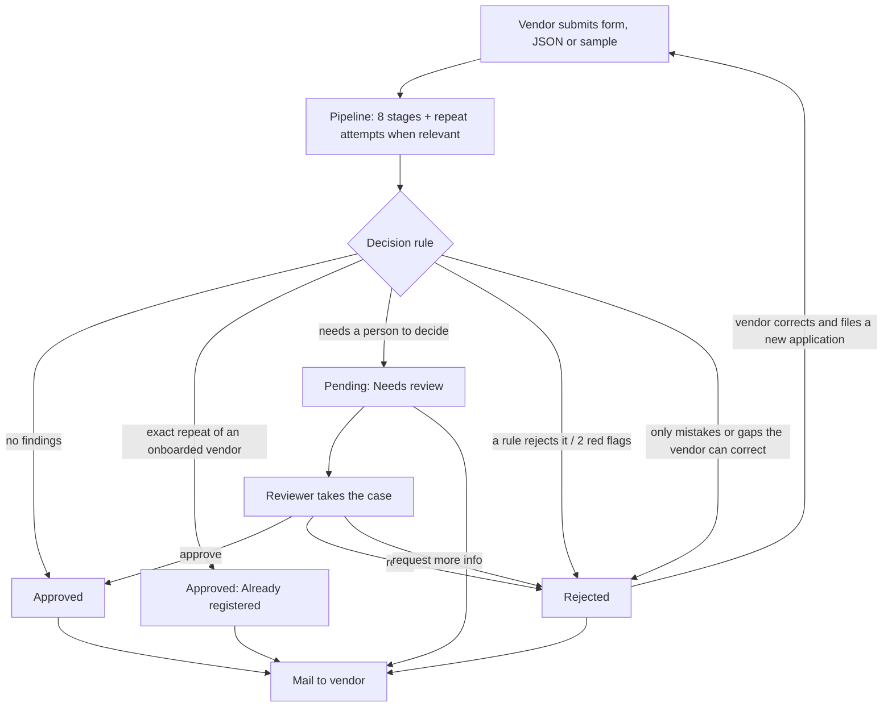
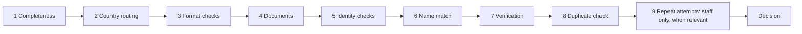
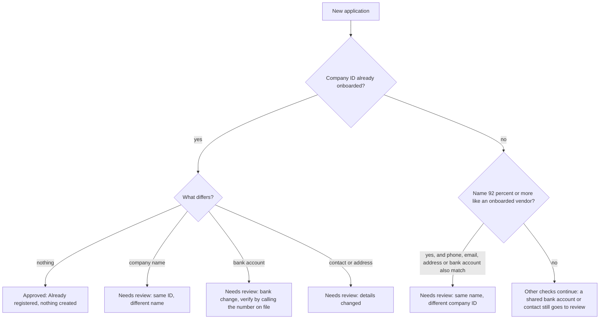
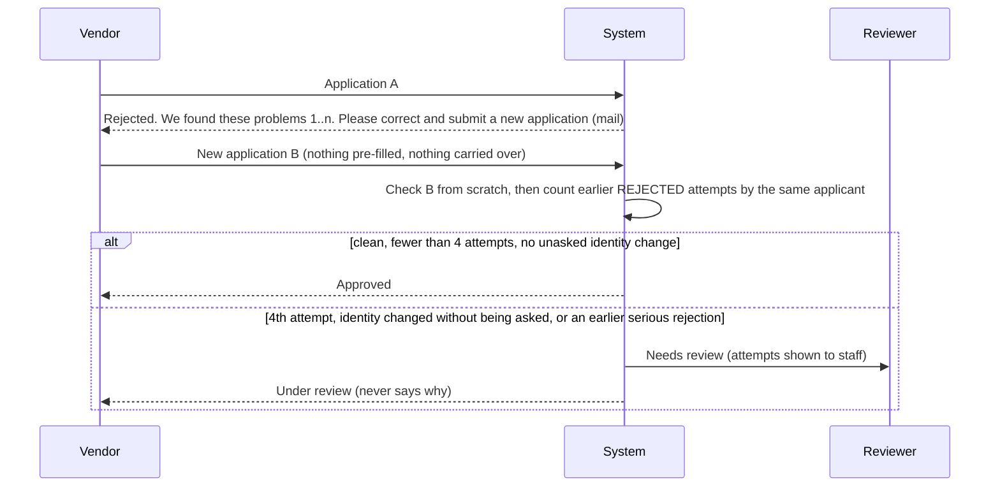
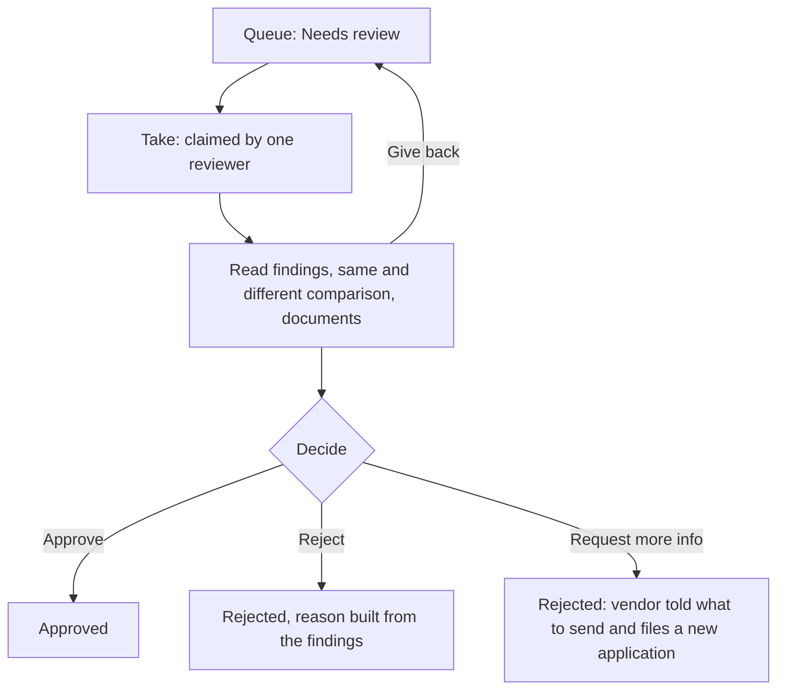
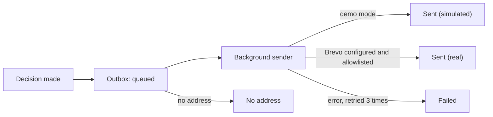

# Workflow: from submission to decision

Diagrams use Mermaid (they render on GitHub, in VS Code with a Mermaid extension, or open `overview.html` in a browser).

## 1. End to end

## 2. The pipeline

Each stage shows live on the Onboard page as it completes. A stage that cannot run is shown as skipped, with the reason (for example "tax ID not in the demo registry, not checked"). Stage 9 is recorded for staff and never shown to the vendor; it only runs when the applicant is not already onboarded and has earlier rejected applications.

## 3. An applicant who is already onboarded, and look-alikes of one

Every one of these review notes tells the reviewer **what is the same and what differs**, for example "Same: company ID, email. Different: company name (Apex Global to Apex Holdings); bank account (****7891 to ****4321)".

## 4. A new application after a rejection

Attempts are linked by company ID, bank account, phone, email, a near-identical company name, or the same uploaded file, within 30 days. Only **rejected** earlier applications count. A change to a field the earlier attempt flagged is expected and is not an identity change. More than 30 submissions an hour from one network address are refused.

## 5. Reviewer desk

Only one reviewer can hold a case; only the holder can decide or give it back. The vendor mail is built automatically from the findings: the reviewer types nothing and nothing internal reaches the vendor.

## 6. Mail

One thread per application: the verdict first, then a reviewer's outcome as "Re: ...". All mail is visible on the Messages page.

## 7. What each person sees

| | Vendor (Onboard page) | Staff (Reviewer desk, Dashboard detail) |
|---|---|---|
| Live stages | Yes (without repeat attempts) | Yes, all recorded stages |
| Vendor message | Yes | No (shown only on the vendor page) |
| Findings table and same/different comparison | No | Yes |
| Flagged-field marks | No | Yes |
| Vendor ID | No | Yes |
| Uploaded documents | Names only | Download |

## 8. Pages

| Page | Purpose |
|---|---|
| Onboard vendor | Form, JSON upload, or sample; live stages; the vendor's message |
| Reviewer desk | Queue, take, decide |
| Dashboard | Counts, history, filters, detail for staff, export CSV |
| Messages | Outbox: every mail and its state |
| About | Statuses, rules, limits, why these countries |
