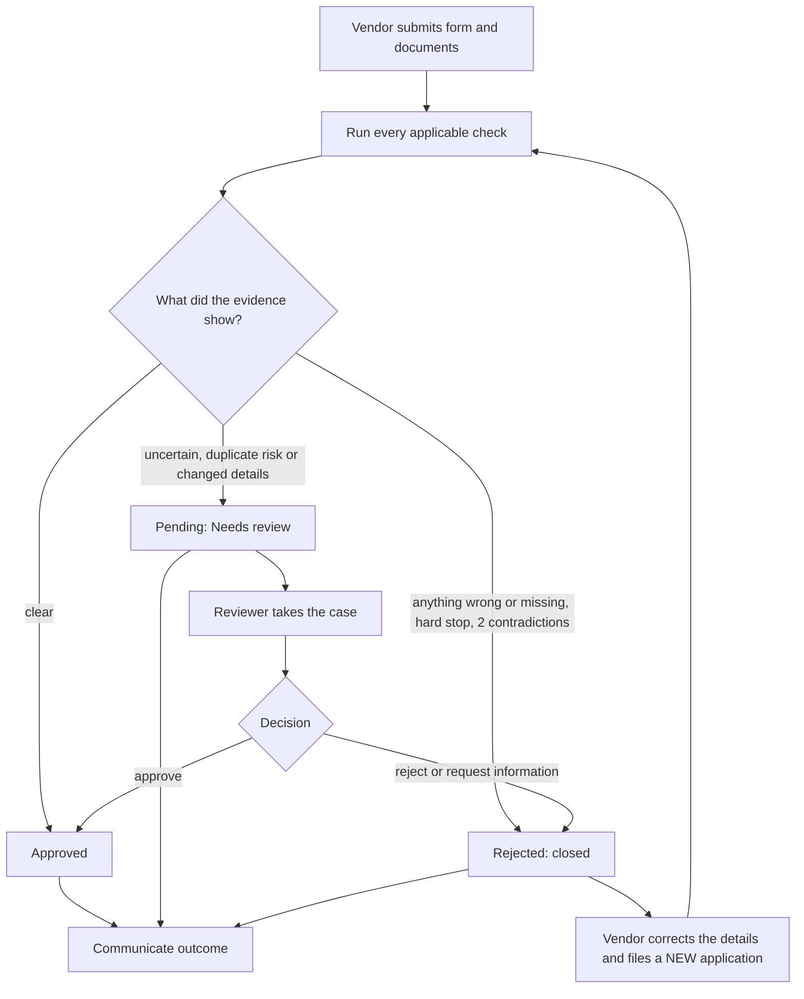
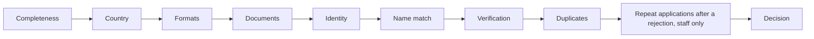
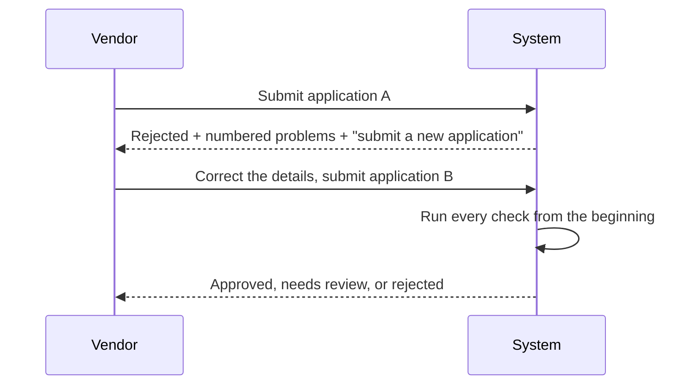

# Workflow: one application, one decision

This is the canonical business flow. The validation-stage diagram is secondary: it explains how evidence is checked, while this diagram explains what happens to a real application.

## 1. End-to-end lifecycle

Every application is decided once. Pending means only that a reviewer must decide. A rejected application is closed, and the vendor files a new one that starts from scratch.

## 2. Validation pipeline

The vendor sees the first eight stages live. Staff see evidence and the internal attempt control. Unknown demo-registry records are marked “not checked”; file type signatures are checked, but document contents are not read.

## 3. Reject, then apply again

No approval is inherited and nothing from application A is reused, not even its documents. Staff see that B follows A.

## 4. Reviewer and bank-risk controls

The server blocks approval of a bank-change/shared-account case until an independent verification method is recorded. The reviewer's note remains internal; the vendor receives safe text generated from the findings.

## 5. Repeat applications after a rejection

Only earlier **rejected** applications count. Applications are linked by company ID, bank account, phone, email, near-identical name or reused file within 30 days. A clean fourth linked application, an unrequested identity change, or a serious earlier rejection goes to a reviewer.

## 6. Communication

Every verdict is written to an outbox before sending. Each application has its own message thread, retries are recorded, and real delivery is allowlisted. The vendor never receives internal reviewer notes, other-vendor details, vendor IDs or the reason a sanctions screen matched.

## 7. Pages

| Page | Purpose |
|---|---|
| Onboard vendor | Submit, watch stages, read the outcome, apply again if rejected |
| Reviewer desk | Queue, claim/release, evidence, independent verification, decision |
| Dashboard | Status/owner metrics, history, details, CSV export |
| Messages | Outbox, delivery state and application threads |
| About | Rules, scope, limits and upgrade path |
