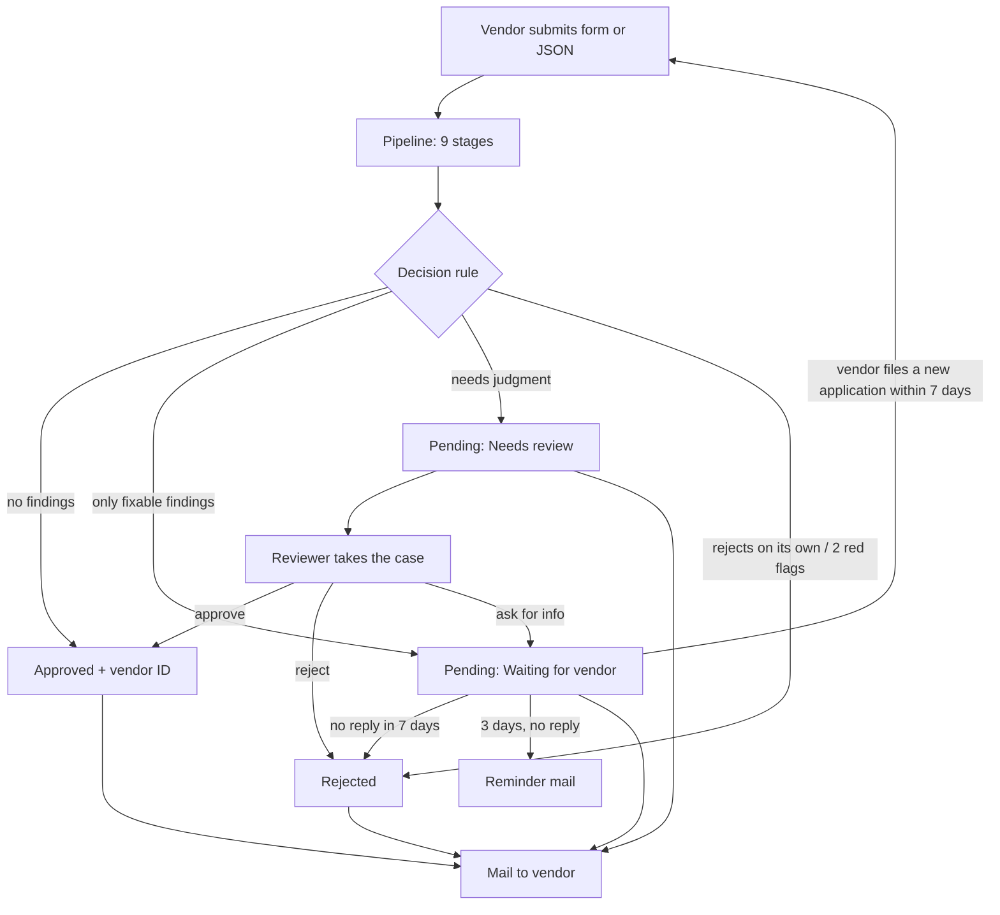
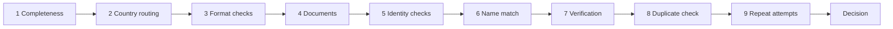
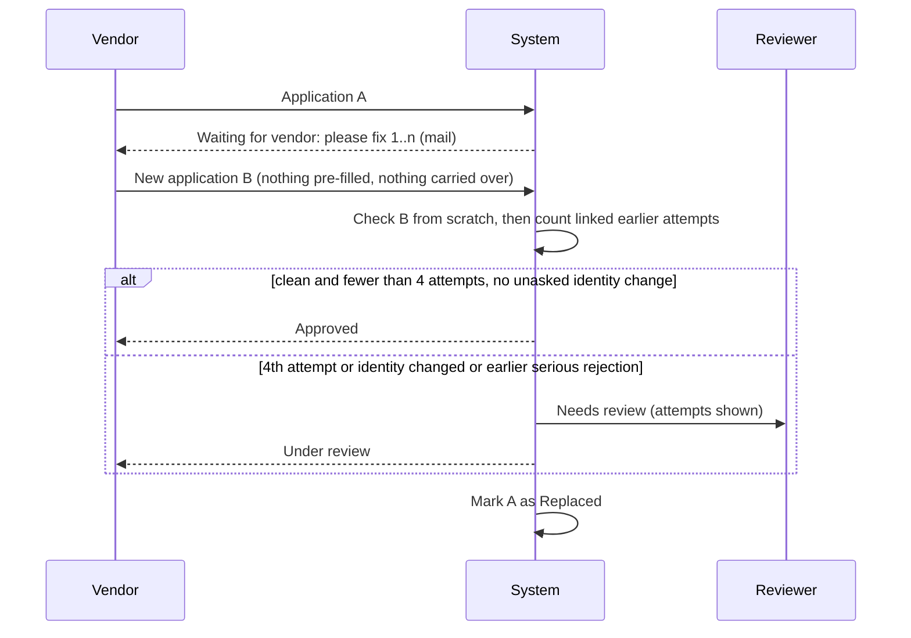
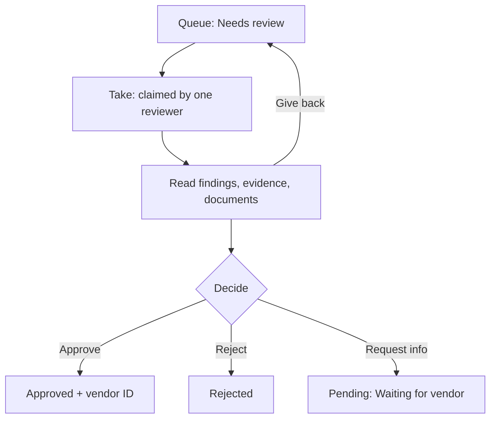
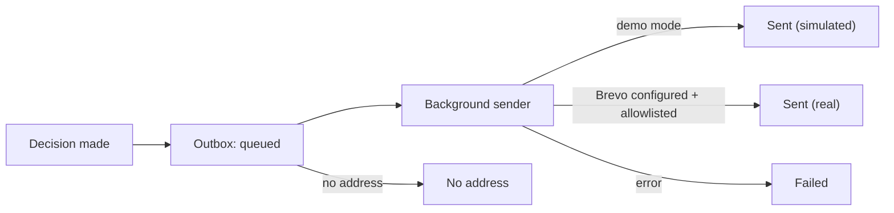

# Workflow: from submission to approval

Diagrams use Mermaid (they render on GitHub, in VS Code with a Mermaid extension, or open `overview.html` in a browser).

## 1. End to end

## 2. The pipeline

Each stage shows live on the run page as it completes. A stage that cannot run (for example country not supported) is shown as skipped, with the reason.

## 3. A new application after a fix request

Attempts are linked by company ID, bank account, phone, email, a near-identical company name, or the same uploaded file, within 30 days. A change to a field the earlier attempt flagged is expected and not an identity change.

## 4. Reviewer desk

Rules: only one reviewer can hold a case; only the holder can decide or give it back. The vendor mail is built automatically from the findings.

## 5. Mail

One thread per application: first mail "Your vendor application (id)", later ones "Re: …". All mail is visible on the Messages page.

## 6. Pages

| Page | Purpose |
|---|---|
| Onboard vendor | Form, JSON upload, or sample; live stages; vendor message |
| Run page | One submission: stages, findings, evidence, documents |
| Review desk | Queue, take, decide |
| Dashboard | Counts, history table, export CSV |
| Messages | Outbox: every mail and its state |
| About | Rules, limits, why these countries |
