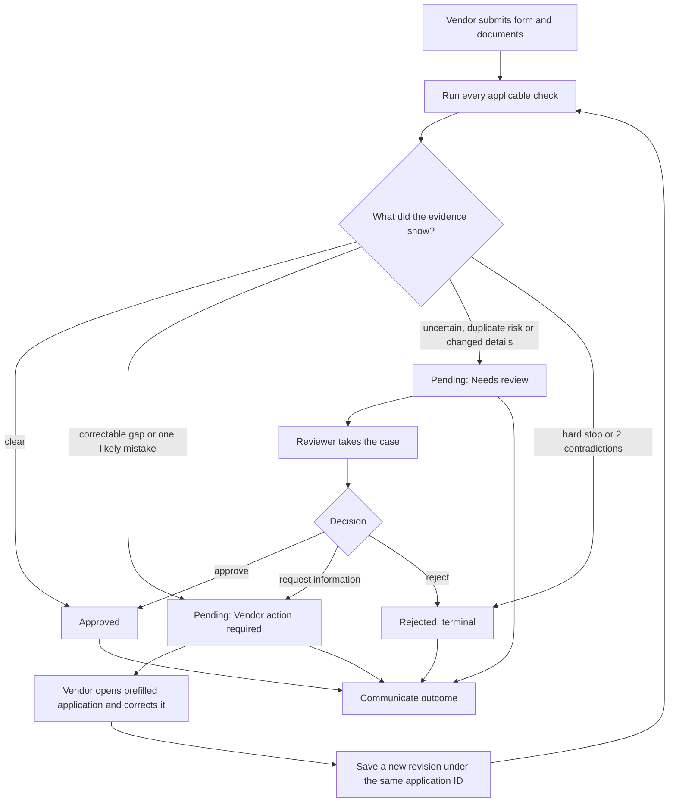
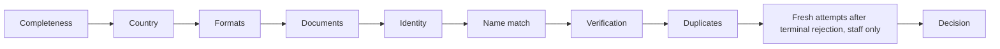
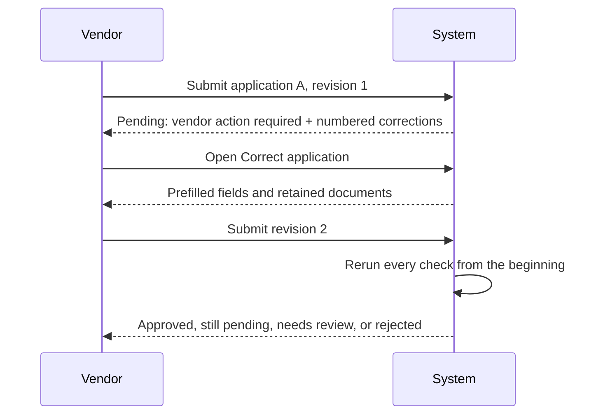
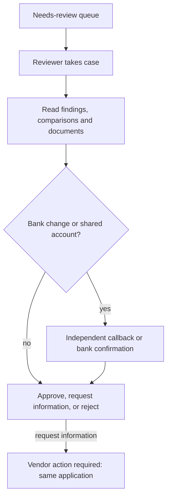

# Workflow: one application, one clear owner

This is the canonical business flow. The validation-stage diagram is secondary: it explains how evidence is checked, while this diagram explains what happens to a real application.

## 1. End-to-end lifecycle

The owner is always visible: vendor, reviewer, or nobody because the case is complete.

## 2. Validation pipeline

The vendor sees the first eight stages live. Staff see evidence and the internal attempt control. Unknown demo-registry records are marked “not checked”; file type signatures are checked, but document contents are not read.

## 3. Correction loop

No approval is inherited. Old revisions remain in the audit trail, while only the latest revision is actionable. Corrections do not count as fresh attempts.

## 4. Reviewer and bank-risk controls

The server blocks approval of a bank-change/shared-account case until an independent verification method is recorded. The reviewer's note remains internal; the vendor receives safe text generated from the findings.

## 5. Fresh applications after terminal rejection

Only earlier **terminally rejected** applications count. Applications are linked by company ID, bank account, phone, email, near-identical name or reused file within 30 days. A clean fourth linked application, an unrequested identity change, or a serious earlier rejection goes to a reviewer. This control is separate from the normal correction loop.

## 6. Communication

Every verdict is written to an outbox before sending. Messages are grouped by application ID, retries are recorded, and real delivery is allowlisted. The vendor never receives internal reviewer notes, other-vendor details, vendor IDs or the reason a sanctions screen matched.

## 7. Pages

| Page | Purpose |
|---|---|
| Onboard vendor | Submit, watch stages, read the outcome, correct an open application |
| Reviewer desk | Queue, claim/release, evidence, independent verification, decision |
| Dashboard | Status/owner metrics, history, details, CSV export |
| Messages | Outbox, delivery state and application threads |
| About | Rules, scope, limits and upgrade path |
